# WE HELP — You Are Not Alone

A multi-page website for **WE HELP**, a mental health support service offering
24/7 text and hotline support, connections to professional therapy, and a
judgment-free space for anyone facing a mental health struggle in South Africa.

**Live site:** https://wehelpdealwithmentalhealth.netlify.app &nbsp;·&nbsp;
**Repository:** https://github.com/Kalila-Tech/WEHELP-Website.git

**Current stage:** Part 3 — Enhancing Functionality and SEO (JavaScript, forms,
search engine optimisation, security, deployment). Part 1 (HTML structure) and
Part 2 (CSS and responsive design) are documented further down and are still
part of the site.

---

## Contents

1. [Project overview](#project-overview)
2. [How to view the site](#how-to-view-the-site)
3. [File structure](#file-structure)
4. [Pages](#pages)
5. [Part 3: Functionality](#part-3-functionality)
6. [Part 3: Forms and validation](#part-3-forms-and-validation)
7. [Part 3: Search engine optimisation (SEO)](#part-3-search-engine-optimisation-seo)
8. [Part 3: Page speed and security](#part-3-page-speed-and-security)
9. [Testing and screenshot evidence](#testing-and-screenshot-evidence)
10. [Accessibility](#accessibility)
11. [Deployment](#deployment)
12. [Content to confirm before launch](#content-to-confirm-before-launch)
13. [Part 1 feedback and how it was addressed](#part-1-feedback-and-how-it-was-addressed)
14. [Part 2: CSS and design](#part-2-css-and-design)
15. [Responsive design](#responsive-design)
16. [Git workflow](#git-workflow)
17. [Changelog](#changelog)
18. [References](#references)

---

## Project overview

| | |
|---|---|
| **Purpose** | Give people in distress a calm, trustworthy place to find help quickly: crisis numbers, a text line, therapy connections, and ways to volunteer or sponsor. |
| **Target audience** | People in South Africa facing mental health struggles, and friends or family looking for help on someone's behalf. Many visitors will be on a phone and may be upset, so the site must be fast, readable and simple. A second audience is potential volunteers and sponsors. |
| **Goals** | 1. Put emergency and crisis numbers within one tap on every page and device. 2. Feel calm and safe, not clinical. 3. Be fully usable on phones, tablets and desktops. 4. Meet accessibility expectations (keyboard use, contrast, reduced motion). 5. Be found by people searching for mental health support in South Africa. 6. Let visitors enquire, volunteer, sponsor or get in touch without friction. |

## How to view the site

Open `index.html` in a browser, or serve the folder with a local server:

```
python3 -m http.server 8000
# then browse to http://localhost:8000/
```

The site needs **no internet connection** except for the map tiles on the
Contact page (they come from OpenStreetMap). Fonts, icons, jQuery and Leaflet
are all stored in the project.

Opened straight from disk (`file://`), browsers block `fetch()`. The site is
built to cope: the Books page keeps the books already written in its HTML, and
the enquiry form and search fall back to simpler wording. For the full
experience use a local server or the deployed site.

## File structure

```
WEHELP-Website/
├── index.html            Home page
├── about.html            About Us
├── services.html         Services + FAQ accordion
├── gallery.html          Gallery with lightbox
├── books.html            Recommended reading with search, filter and sort
├── enquiry.html          Enquiry form (volunteer, sponsor, therapy, information)
├── contact.html          Contact details, contact form, interactive map
├── 404.html              "Page not found" page
├── style.css             The one external stylesheet (linked from every page)
├── js/
│   ├── main.js           Menu, help dialog, back-to-top, search, animations, share links
│   ├── validate.js       Shared form validation
│   ├── enquiry.js        Enquiry form + AJAX
│   ├── contact.js        Contact form → compiled email
│   ├── lightbox.js       Gallery lightbox (jQuery)
│   ├── accordion.js      FAQ accordion (jQuery)
│   ├── books.js          Books: AJAX load, search, filter, sort (jQuery)
│   └── map.js            Leaflet map + "show my location"
├── data/
│   ├── books.json        Book list loaded with AJAX
│   ├── enquiry.json      Costs, availability and next steps shown after an enquiry
│   └── locations.json    Map pin(s)
├── fonts/                Inter and Fraunces (self-hosted) + licences
├── vendor/               jQuery 3.7.1, Leaflet 1.9, Font Awesome subset (self-hosted) + licences
├── wehelp-pictures/      Gallery photos (descriptive names; 320px, 480px, full size; JPEG + WebP) and og-image.png
├── favicon.svg, favicon-32.png, apple-touch-icon.png
├── robots.txt            Crawler rules + sitemap location
├── sitemap.xml           All seven pages
├── _headers              Security and caching headers for Netlify
├── .nojekyll             Tells GitHub Pages to serve the files as they are
├── set-site-url.sh       One-command replacement of the placeholder site address
├── screenshots/          Device and feature screenshots used below
└── README.md             This document
```

## Pages

Every page shares the same header, navigation bar, "Need help now?" button and
footer, and links to every other page with ordinary page links.

| Page | File | Content |
|---|---|---|
| Home | `index.html` | Hero with the animated "breathing" visual, mission, "What We Provide", links to every other page |
| About | `about.html` | Who we are and what we believe |
| Services | `services.html` | Text line, hotline, therapy support, and a five-question FAQ accordion |
| Gallery | `gallery.html` | Six captioned photos; click one to open the lightbox |
| Books | `books.html` | Six recommended books with search, topic filter and sort |
| Enquiry | `enquiry.html` | Enquire about volunteering, sponsoring, therapy referral or the text line and hotline, and get an instant response |
| Contact | `contact.html` | Hotline, text line, email, Lifeline, Suicide Crisis Line, emergency numbers, contact form, interactive map |
| 404 | `404.html` | Friendly "not found" page with links home and the crisis numbers (not listed in the sitemap, `noindex`) |

---

## Part 3: Functionality

### Interactive elements

| Element | Where | How it works |
|---|---|---|
| **Accordion** | Services page, FAQ | Built on native `<details>` elements so the answers work without JavaScript. jQuery adds smooth `slideDown`/`slideUp`, one-open-at-a-time, "Expand all" / "Collapse all" and deep links such as `services.html#faq-3`. |
| **Modal: "Need help now?"** | Every page | A button in the header opens a modal `<dialog>` listing emergency and crisis numbers as tap-to-call links. Escape or the close button closes it, and focus returns to the button. |
| **Modal: photo lightbox** | Gallery page | Each photo is a link to the full image (so it still works without JavaScript). jQuery builds a modal `<dialog>` with DOM manipulation: larger uncropped photo, caption, "Photo 2 of 6" counter, previous/next buttons, arrow keys, swipe, Escape and click-outside to close. |
| **Interactive map** | Contact page | Leaflet with OpenStreetMap tiles. Pins are loaded from `data/locations.json`; a popup shows the details and a "Get directions" link. **Show my location** uses the browser's geolocation to place you on the map and tell you the distance to WE HELP. The position stays in the browser. |
| **Tabs** | — | Not used. The accordion and two modals cover the "accordions, tabs or modals" requirement. |

### Animations and transitions

* **Scroll reveal:** cards, form panels, photos and the map fade up when they scroll into view (`IntersectionObserver`). Anything already visible is left alone, and nothing is hidden if JavaScript is off.
* **CSS transitions:** card lift, button press, navigation underline, accordion chevron turning, dialog and lightbox fade-in.
* **Keyframe animations:** the Home page "breathing" rings and the swaying logo emoji.
* **Reduced motion:** all of the above switch off when the visitor prefers reduced motion (CSS `prefers-reduced-motion`, and the same check in the scripts).

### Advanced DOM manipulation

The lightbox, the book cards, the search results, the enquiry response, the
email preview, the map popups and the scroll-reveal classes are all created or
changed with JavaScript (`createElement`, `appendChild`, `textContent`,
`classList`, `dataset`/`data-*` attributes, event delegation). Visitor-supplied
text is always inserted with `textContent`, never `innerHTML`, so it cannot
inject markup.

### Dynamic content

| Content | Source | Where |
|---|---|---|
| Book cards | `data/books.json`, loaded with `$.getJSON` (AJAX) and rendered as cards | Books |
| Map pins | `data/locations.json`, loaded with `fetch()` | Contact |
| Enquiry response rules (costs, availability, next steps) | `data/enquiry.json`, loaded with `fetch()` after the form is submitted | Enquiry |
| Search across pages | The other pages are fetched and searched when you search | Every page |

### Search, filter and sort

* **Books page:** a search box (searches title, author, topic and description), a topic filter (Depression and anxiety, Trauma, Grief, Self-compassion), a sort menu (title A–Z / Z–A, author A–Z / Z–A) and a Reset button. A live message says how many of the six books are showing, and an empty-state message appears when nothing matches.
* **Site search (header):** press Enter to search every page; a drop-down lists matching pages with a snippet, and opening one highlights the match.

---

## Part 3: Forms and validation

The brief asks for two forms with different purposes.

| | **Enquiry** (`enquiry.html`) | **Contact** (`contact.html`) |
|---|---|---|
| **Purpose** | Ask about a specific thing and get an answer straight away: volunteering, sponsoring, a therapy referral, or the text line and hotline. | Send a general message to the organisation. |
| **Fields** | Full name, email, phone, enquiry type (select), hours per week (volunteer only) or monthly pledge in rand (sponsor only), preferred contact date, preferred time (select), message, consent checkbox | Full name, email, phone (optional), type of message (select), message, consent checkbox |
| **What happens after validation** | The page shows a response about **cost** and **availability**, the visitor's **level** (sponsor) or **shifts** (volunteer), when the team will contact them, a reference number and the next steps. | The page compiles an **email** to support@wehelp.org (shown with To, Subject and body), and the visitor sends it with "Send email" from their own email app. "Copy text" and "Edit message" are also offered. |
| **Recipient** | support@wehelp.org (`data-recipient`) | support@wehelp.org (`data-recipient` and the form's `action`) |

### Client-side validation (JavaScript, `js/validate.js`)

Every rule is also written as an HTML5 attribute (`required`, `type`,
`minlength`, `maxlength`, `min`, `max`, `pattern`), so the browser still helps
when JavaScript is off. The forms use `novalidate` so that the script can show
friendly messages in the page instead of the browser's pop-ups.

| Field | Rule |
|---|---|
| Full name | Required, 2–60 characters, letters, spaces, hyphens, apostrophes and full stops only |
| Email | Required, must look like `name@example.com` |
| Phone | South African number: `0` or `+27` or `0027`, then 9 digits (e.g. `072 055 3717` or `+27 72 055 3717`); spaces and brackets are ignored. Required on Enquiry, optional on Contact |
| Select menus | Must choose an option |
| Hours per week | Whole number from 1 to 40 |
| Monthly pledge | Whole number from R50 to R100 000 |
| Preferred date | A real date, today or later, within the next 90 days (the date picker also limits this) |
| Message | Enquiry 10–500 characters; Contact 20–1000 characters; live "123 / 500" counter |
| Consent | Must be ticked (POPIA) |

### Error handling

* A field is checked when you leave it, then re-checked as you type until it is fixed.
* Each error appears in red text under its field, linked with `aria-describedby`, announced with `role="alert"`, and the field gets `aria-invalid="true"`.
* On submit, the first invalid field receives focus and a summary says how many fields need fixing.
* A hidden "honeypot" field catches simple bots, and line breaks are stripped from anything placed in an email subject so the subject cannot be hijacked.

### AJAX and the form `action`

* **Enquiry:** on submit the page does not reload. `fetch()` loads `data/enquiry.json` (the response rules) and, when a form service is connected, also POSTs the form data to the form's `action` URL (`https://formspree.io/f/YOUR_FORM_ID`). The response is then built in the page. If the request fails, a clear message with the phone number and email address is shown.
* Until a real Formspree form ID is added (see [Deployment](#deployment)), the response also offers **Email this enquiry**, which compiles the enquiry into an email to the team, so enquiries are never lost.
* **Contact:** the form's `action` is `mailto:support@wehelp.org` (the fallback when JavaScript is off). With JavaScript the message is validated and compiled without reloading the page. No network request is needed, because the message is sent by the visitor's own email app, as the brief describes.

---

## Part 3: Search engine optimisation (SEO)

### Keyword research

No paid tool was used. The keywords below were chosen from how a person in
South Africa is likely to phrase a search (the intent behind it) and then
worked into titles, headings and descriptions. They should be checked against
real search data in Google Search Console once the site has been live for a few
weeks.

| Keyword or phrase | Search intent | Where it is used |
|---|---|---|
| mental health support South Africa | Find help | Home title and description, About description |
| 24/7 text line / 24/7 hotline | Find immediate help | Home title and H2, Services title, H1 and H2s |
| suicide crisis line, Lifeline helpline | Crisis numbers | Contact title, description, headings and body |
| therapy referral, professional therapy | Find a therapist | Enquiry title, Services copy and FAQ |
| volunteer / sponsor mental health | Get involved | Enquiry title, description and form |
| mental health books, depression, anxiety, trauma, grief | Read and learn | Books title, description, topic filter |
| peer support, community | Find a community | Gallery title, description, H2 |

### On-page SEO

| Requirement | What was done |
|---|---|
| **Title tags** | A unique title on every page, 42–56 characters, with the main keyword near the front (see table below) |
| **Meta descriptions** | A unique, action-oriented description on every page, 111–153 characters |
| **Header tags** | One `<h1>` per page and no skipped levels (h1 → h2 → h3). Card titles on Services and Books are `h2`; the Home cards are `h3` under the "What We Provide" `h2`. Checked automatically on all seven pages. |
| **Image optimisation** | Descriptive file names (`support-line-headset-operator.jpg`, `group-conversation-circle.jpg`, …) instead of `gallery-3.jpg`; descriptive `alt` text on every image; `width` and `height`; WebP and three sizes with `srcset`/`sizes`; `loading="lazy"` |
| **URL structure** | Short, lowercase, descriptive page names: `/about.html`, `/services.html`, `/enquiry.html`, `/contact.html`. A `<link rel="canonical">` on every page. |
| **Internal linking** | The main menu and footer on every page, plus links inside the text: Home links to all six other pages; About, Services, Gallery and Books each point on to the Enquiry page (and to Contact where it fits); FAQ answers link to the enquiry form; the 404 page links home. |
| **Mobile-friendliness** | Viewport meta tag, responsive layout at three breakpoints, tap-to-call links, touch-sized buttons. Lighthouse SEO: 100 on mobile and desktop for the pages tested. |
| **Social previews** | Open Graph and Twitter Card tags with a 1200 × 630 share image on every page |
| **Structured data (JSON-LD)** | `NGO` (name, logo, phone, 24/7 hours, area served: South Africa) on the Home page; `FAQPage` on the Services page |

| Page | Title tag |
|---|---|
| Home | WE HELP \| 24/7 Mental Health Support in South Africa |
| About | About WE HELP \| Mental Health Support Organisation |
| Services | Services \| 24/7 Text Line, Hotline & Therapy Support |
| Gallery | Gallery \| WE HELP Community & Peer Support |
| Books | Mental Health Books \| Recommended Reading \| WE HELP |
| Enquiry | Enquiry \| Volunteer, Sponsor or Ask for Therapy Referral |
| Contact | Contact WE HELP \| Crisis Lines, Text & Email Support |

### Off-page SEO (plan)

Off-page SEO happens outside the website, so this section is a plan rather
than something that can be shipped in the code. What is in the code is the
groundwork.

| Area | In the code | Plan after launch |
|---|---|---|
| **Backlinks** | Share image, canonical URLs and an `NGO` record make the site easy to cite | Ask South African mental health organisations, university counselling services, NGOs and local news to list WE HELP; write a short guest article; register in non-profit directories. Aim for a few relevant, trustworthy links, not many weak ones. |
| **Social media** | Footer icons, "Share this page" links (WhatsApp, Facebook, Twitter, LinkedIn) and Open Graph tags so shared links show a title, description and picture | Post the helpline details and one resource each week; link every post to the matching page; use a consistent name (WE HELP) on every profile. |
| **Local SEO** | "South Africa" in titles and descriptions, `areaServed: ZA`, South African phone and emergency numbers, `en_ZA` locale, map on the Contact page | Create and verify a Google Business Profile with the real address and hours; keep name, address and phone number identical everywhere; ask partners for reviews. |

### Additional requests

* **`robots.txt`:** allows all crawlers, blocks `/screenshots/` (test images, not content) and points to the sitemap.
* **`sitemap.xml`:** lists all seven pages with `lastmod`, `changefreq` and `priority`. Submit it in Google Search Console after launch.
* **`404.html`:** friendly error page with `noindex`, links home and the crisis numbers.

---

## Part 3: Page speed and security

### Page speed

| Technique | Detail |
|---|---|
| Fewer third-party requests | Fonts (Inter, Fraunces), icons (a 26-icon Font Awesome subset of about 4 KB), jQuery and Leaflet are stored in the project. The only outside request is map tiles on the Contact page. |
| Fonts | Only the weights used, as `woff2`, `font-display: swap`, the two most important preloaded |
| Images | WebP plus JPEG in three sizes, `srcset`/`sizes`, explicit `width`/`height` (no layout jumps), lazy loading |
| Scripts | All scripts use `defer`; each page loads only what it needs (the map code and Leaflet load only on the Contact page, jQuery only on the three pages that use it) |
| Caching | `_headers` sets one-year caching for images, fonts and vendor files (Netlify) |

Lighthouse (Chrome, run against a local server with simulated mobile
throttling for the mobile rows):

| Page | Device | Performance | Accessibility | Best practices | SEO | Largest paint |
|---|---|---|---|---|---|---|
| Home | Mobile | 97 | 100 | 100 | 100 | 2.3 s |
| Home | Desktop | 100 | 100 | 100 | 100 | 0.5 s |
| Services | Mobile | 95 | 100 | 100 | 100 | 2.6 s |
| Services | Desktop | 100 | 100 | 100 | 100 | 0.6 s |
| Contact | Mobile | 90 | 100 | 96 | 100 | 3.4 s |
| Contact | Desktop | 100 | 100 | 96 | 100 | 0.8 s |

The 96 on the Contact page is not a site problem: the test machine could not
reach OpenStreetMap, so the map tile requests failed and were logged as console
errors. Scores will vary a little on a real host. An automated axe-core
accessibility scan of all seven pages at desktop and mobile size found **no
violations**.

### Security

| Measure | Detail |
|---|---|
| **Content Security Policy** | Every page has a CSP: scripts, styles and fonts only from the site itself, images only from the site and OpenStreetMap, no plugins (`object-src 'none'`), forms may only post to the site, `mailto:` or Formspree. No inline scripts or `style` attributes anywhere (the JSON-LD blocks are data, not code), so `unsafe-inline` is not needed. |
| **No third-party scripts** | jQuery, Leaflet, fonts and icons are stored in the project with their licences, so no outside site can change the code that runs on the page. |
| **Security headers** | `_headers` (Netlify) adds `X-Content-Type-Options`, `X-Frame-Options: DENY`, `frame-ancestors 'none'`, `Referrer-Policy`, `Permissions-Policy` (geolocation only for the site itself; camera, microphone and payment off) and HSTS. GitHub Pages cannot set headers, so the CSP and referrer policy are also set with `<meta>` tags. |
| **HTTPS** | GitHub Pages and Netlify serve the site over HTTPS. |
| **Safe links** | External links use `rel="noopener noreferrer"`. |
| **Safe forms** | Validation on every field with length limits; honeypot field; visitor text is inserted with `textContent` (never `innerHTML`); line breaks stripped from email subjects; `encodeURIComponent` on everything placed in a `mailto:` link; no secrets or keys in the code. |
| **Privacy** | POPIA notice and consent checkbox on both forms; geolocation is optional, runs only when the visitor clicks, and the position never leaves their browser. |

Limits worth knowing: client-side validation can be bypassed, so a form
service such as Formspree should do its own checks too, and a `<meta>` CSP
cannot set `frame-ancestors` (the Netlify `_headers` file does).

---

## Testing and screenshot evidence

**Method.** Each page was loaded in Chromium using its device emulation (the
same engine and device toolbar as Chrome DevTools) at the sizes below, and
captured as a full-page screenshot, after scrolling so lazy images and
scroll animations have appeared. All images are in [`screenshots/`](screenshots/).
An automated test script also checked, on every page: no console errors or CSP
violations; one `<h1>` and no skipped heading levels; title, description,
canonical and share image present; every link, image and `srcset` file
resolves; alt text on every image; no inline styles; no horizontal scrolling at
eight widths from 1440px to 320px. It then exercised the help dialog, FAQ,
lightbox, books search/filter/sort, both forms (blank, invalid and valid input),
the map, geolocation and the `file://` fallbacks. All checks pass.

> The map tiles come from OpenStreetMap, which the machine used for testing
> could not reach, so the map screenshots show the pin and popup on a blank
> background. On the live site the street map appears behind them.

### Features in use

| Gallery lightbox | FAQ accordion | Books search, filter and sort |
|---|---|---|
| 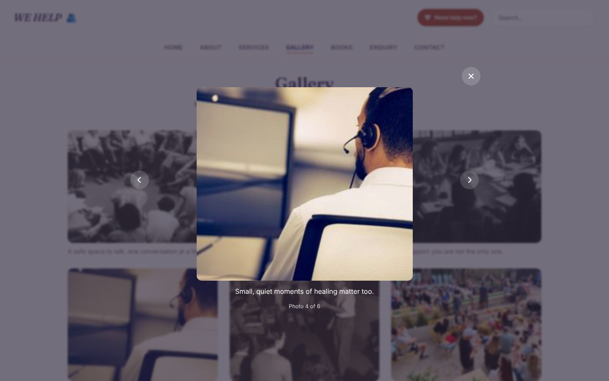 | 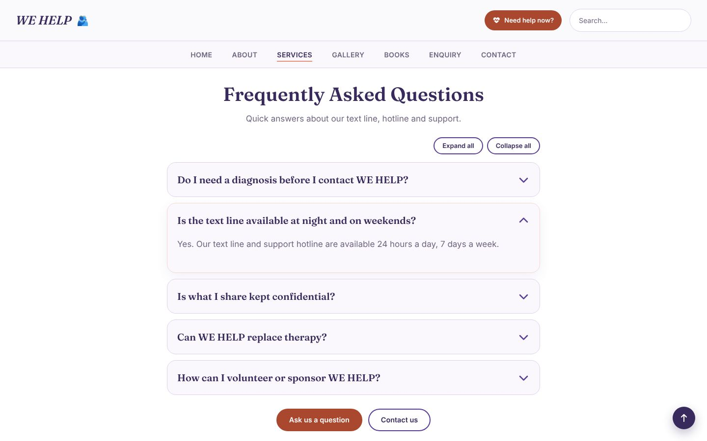 | 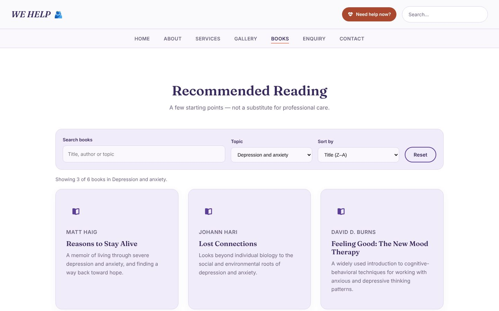 |

| "Need help now?" dialog | Interactive map |
|---|---|
| 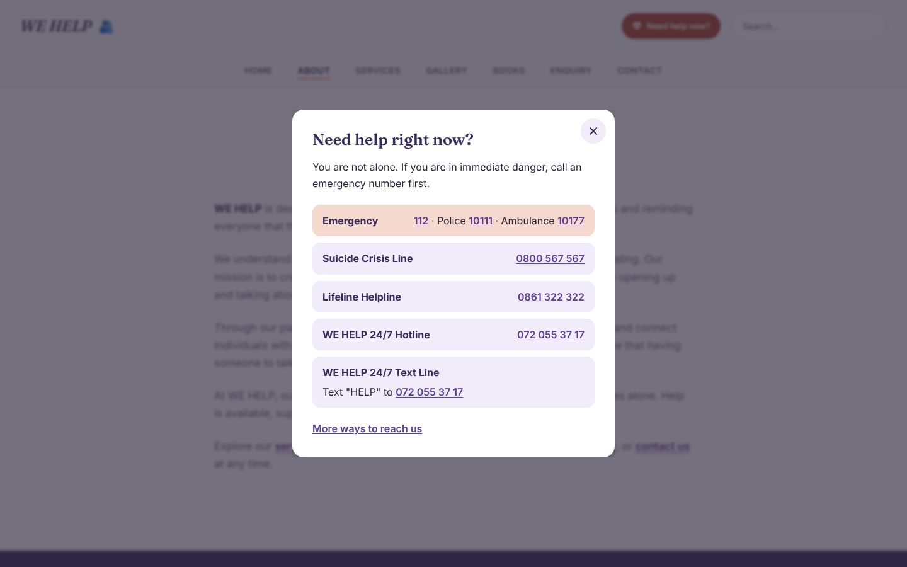 | 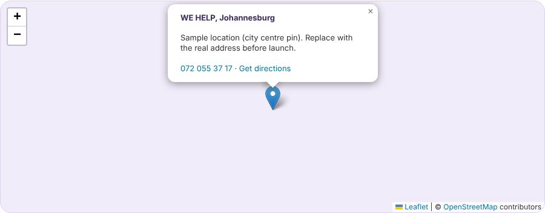 |

| Contact form: errors | Contact form: email ready |
|---|---|
| 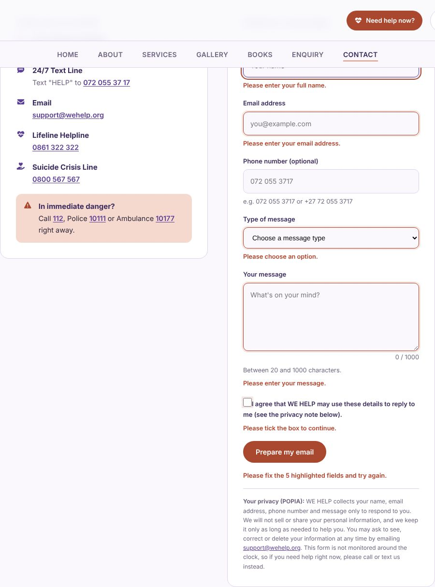 | 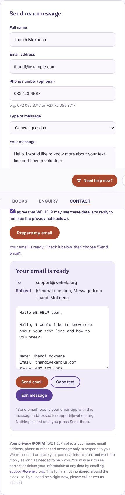 |

| Enquiry form: errors | Enquiry response (sponsor) |
|---|---|
| 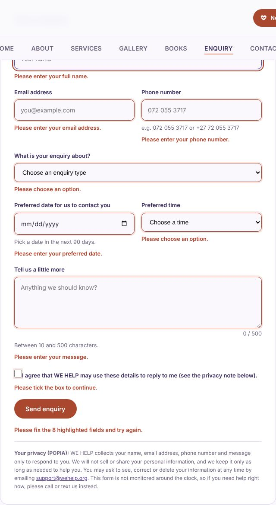 | 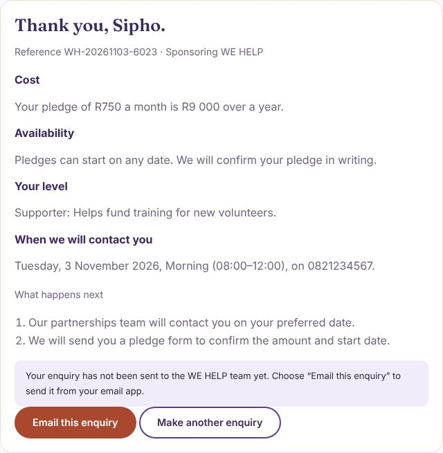 |

### Desktop — 1440 × 900

| Home | Services | Enquiry | Contact |
|---|---|---|---|
| 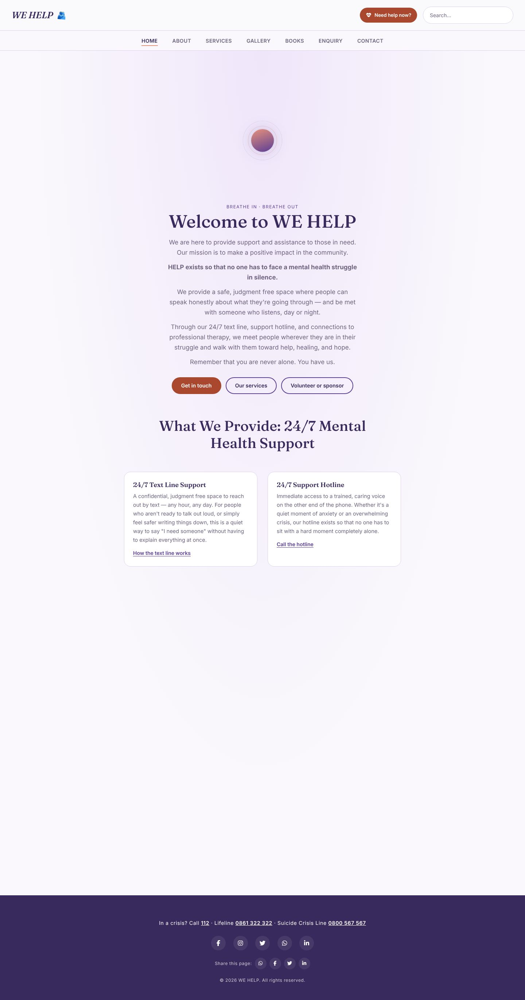 | 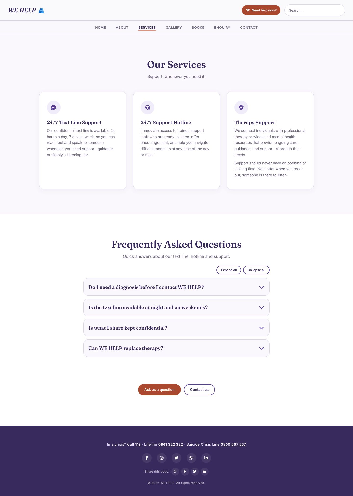 | 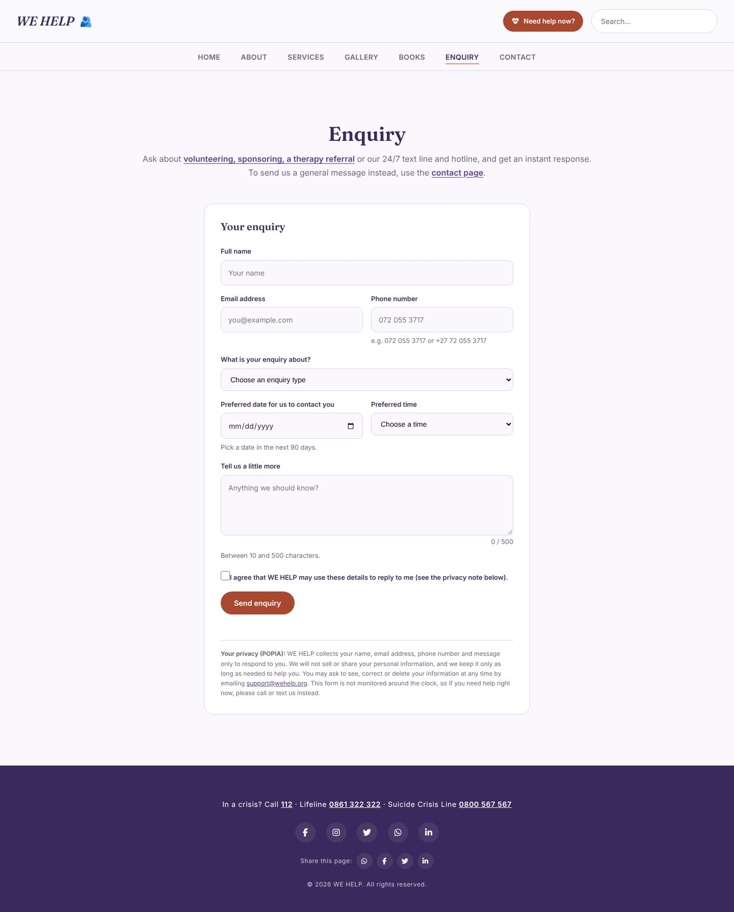 | 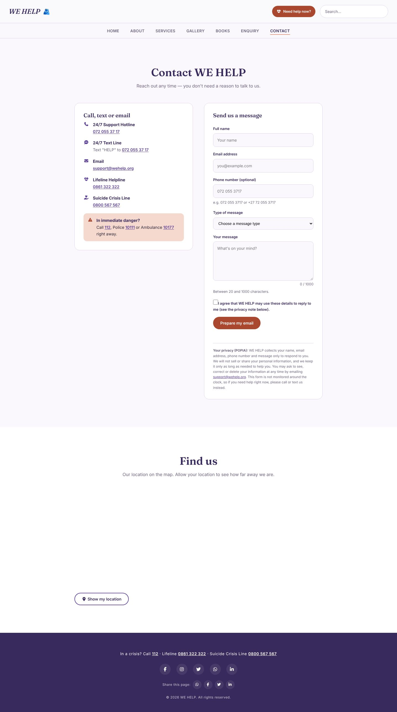 |

Other pages: [About](screenshots/desktop-1440x900-about.jpg) ·
[Gallery](screenshots/desktop-1440x900-gallery.jpg) ·
[Books](screenshots/desktop-1440x900-books.jpg)

### Tablet

| iPad Mini 768 × 1024: Home | iPad Mini: Enquiry | iPad Pro 11 834 × 1194: Home | iPad Pro 11: Enquiry |
|---|---|---|---|
| 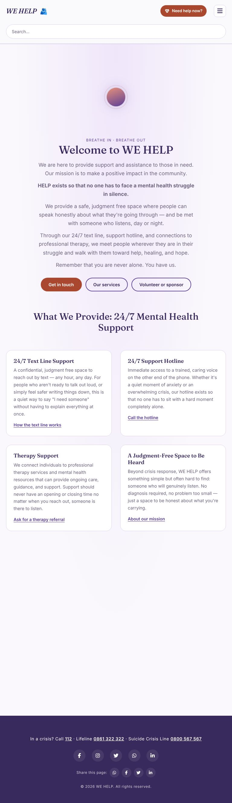 | 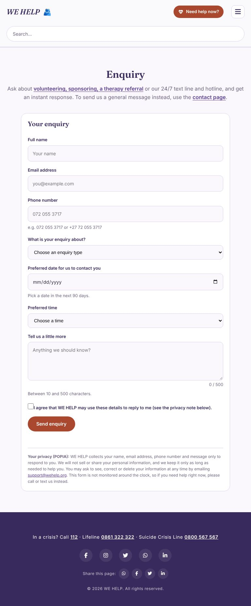 | 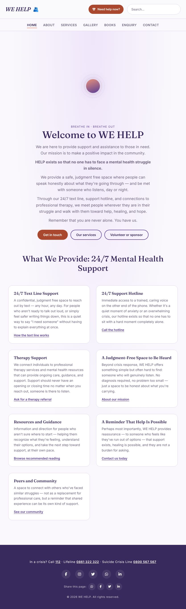 | 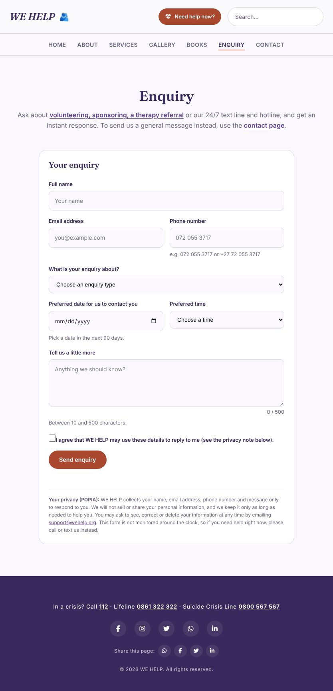 |

Other iPad Mini pages: [About](screenshots/tablet-ipad-mini-768x1024-about.jpg) ·
[Services](screenshots/tablet-ipad-mini-768x1024-services.jpg) ·
[Gallery](screenshots/tablet-ipad-mini-768x1024-gallery.jpg) ·
[Books](screenshots/tablet-ipad-mini-768x1024-books.jpg) ·
[Contact](screenshots/tablet-ipad-mini-768x1024-contact.jpg)

The iPad Mini is exactly 768px wide, so it uses the 768px layout (menu button,
single-column forms). The iPad Pro 11 (834px) shows the tablet layout with the
full navigation bar.

### Mobile

| iPhone 13 390 × 844: Home | iPhone 13: menu open | iPhone 13: Enquiry | iPhone 13: Contact |
|---|---|---|---|
| 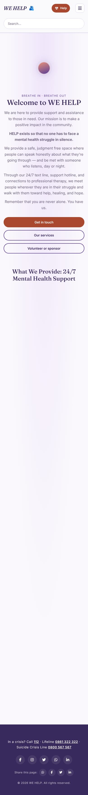 | 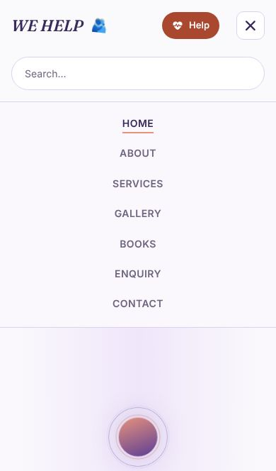 | 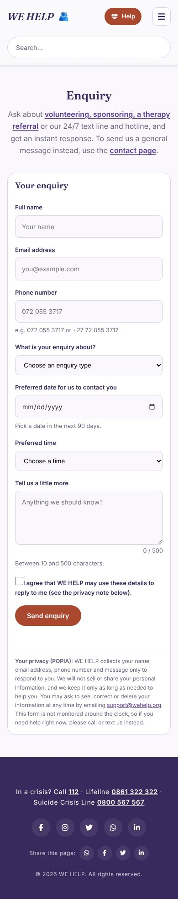 | 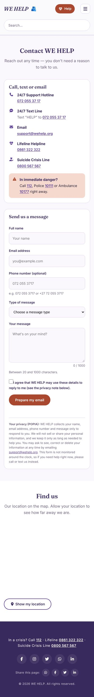 |

| Pixel 7 412 × 915: Home | Pixel 7: Contact | iPhone SE 375 × 667: Home |
|---|---|---|
| 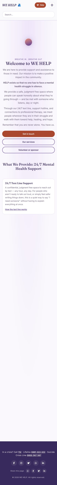 | 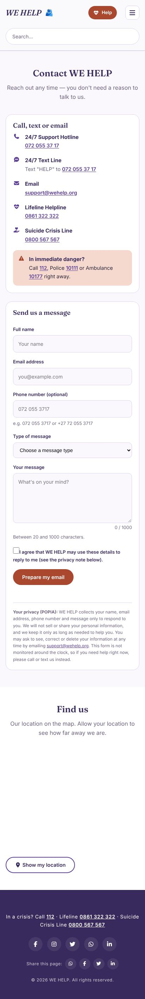 | 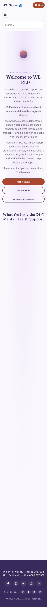 |

Other iPhone 13 pages: [About](screenshots/mobile-iphone-13-390x844-about.jpg) ·
[Services](screenshots/mobile-iphone-13-390x844-services.jpg) ·
[Gallery](screenshots/mobile-iphone-13-390x844-gallery.jpg) ·
[Books](screenshots/mobile-iphone-13-390x844-books.jpg)

---

## Accessibility

* **Skip link** ("Skip to content") to `<main id="main">`; one `<h1>` per page with no skipped heading levels; landmarks (`header`, `nav`, `main`, `footer`); `lang="en"`.
* **Keyboard and focus:** every control has a visible `:focus-visible` outline; the menu button reports `aria-expanded`; the current page link has `aria-current="page"`. Both modals are native `<dialog>` elements, so focus is trapped inside while open, Escape closes them, and focus returns to what opened them.
* **Contrast:** coral text and buttons use `#A9472F` (5.8:1 on white) instead of `#D97B62` (3.0:1). Body text `#6E647F` is 5.5:1 on white.
* **Motion:** `prefers-reduced-motion` turns off the breathing animation, the swaying logo, scroll reveal, accordion animation and smooth scrolling.
* **Forms:** every field has a `<label>`; hints and errors are linked with `aria-describedby`; errors use `role="alert"` and `aria-invalid`; the first error receives focus; the character counter is a live region.
* **Without JavaScript:** the FAQ answers, book list, gallery photos (as links to the full image), contact details and the form's HTML5 rules still work.
* **Images:** every image has descriptive `alt` text.
* **Touch:** phone numbers and email are real `tel:`, `sms:` and `mailto:` links.
* **Automated check:** axe-core (WCAG 2.0 to 2.2 A and AA plus best practices) reports no violations on any of the seven pages at desktop and mobile size.

---

## Deployment

The site is plain HTML, CSS and JavaScript, so any static host works.

### Option A: GitHub Pages (free)

1. Push the project to a GitHub repository (see [Git workflow](#git-workflow)).
2. On GitHub, open **Settings → Pages**. Under **Build and deployment**, choose **Deploy from a branch**, pick the `main` branch and the `/ (root)` folder, and save.
3. After a minute the site is live at `https://YOUR-USERNAME.github.io/REPOSITORY-NAME/`.
4. Replace the placeholder address everywhere (canonical links, share image, sitemap, robots.txt, structured data and this README) with the real one:

   ```
   sh set-site-url.sh https://YOUR-USERNAME.github.io/REPOSITORY-NAME
   ```

   then commit and push again. Also replace `YOUR-USERNAME` in the repository link at the top of this README.
5. Submit `…/sitemap.xml` in Google Search Console.

### Option B: Netlify (free)

Drag the project folder onto the Netlify dashboard (or connect the GitHub
repository). Netlify reads `_headers`, so the full security headers apply.
Then run `set-site-url.sh` with the Netlify address.

### Connecting the enquiry form (optional)

1. Create a free form at https://formspree.io and copy its ID.
2. In `enquiry.html` replace `YOUR_FORM_ID` in the form's `action`.

Enquiries are then sent to the team in the background (AJAX) and the visitor
still sees the instant response. Until this is done, visitors use "Email this
enquiry" instead.

---

## Content to confirm before launch

This is a student project, and some details are sample content that the real
organisation must replace. They are all in one place each:

| Item | Where | Note |
|---|---|---|
| Costs, session dates, pledge levels, response steps | `data/enquiry.json` | Marked as sample terms in the file. These are the figures shown in the enquiry response. |
| Map pin | `data/locations.json` | A pin in central Johannesburg. The popup says it is a sample location. Replace with the real address. |
| Site address | `set-site-url.sh` | Replace the `YOUR-USERNAME` placeholder after deploying |
| Form endpoint | `enquiry.html` | Replace `YOUR_FORM_ID` (Formspree) |
| Social media accounts | Footer on every page | The Facebook, Instagram, Twitter and LinkedIn addresses are guesses; use the real ones |
| Photographs | `wehelp-pictures/` | Stock-style images. Confirm the source and licence, and credit them, before publishing |
| Phone numbers and email | Every page | 072 055 37 17 and support@wehelp.org are as supplied. Lifeline (0861 322 322) and the Suicide Crisis Line (0800 567 567) were checked against a published South African helpline directory. |

---

## Part 1 feedback and how it was addressed

The lecturer's feedback on Part 1 was:

> You have demonstrated good understanding of web development. Your GitHub has
> no detailed commits and read me file. Your websites' navigation seems to be
> using sections instead of webpages, you need to fix it and link other pages.

| Feedback | What was done |
|---|---|
| **Navigation used sections instead of web pages.** | `index.html` was a one-page site whose menu pointed to `#home`, `#about` and so on. It is now the Home page only. The menu on every page links to real pages (`index.html`, `about.html`, `services.html`, `gallery.html`, `books.html`, `enquiry.html`, `contact.html`). The page you are on is marked with `aria-current="page"` and styled as active. The logo links to `index.html`. The duplicate `home.html` was removed (its content is `index.html`), and the scroll-spy code that only made sense on a one-page site was deleted. |
| **GitHub has no read me file / not detailed.** | This README now documents the purpose, audience, file structure, pages, design system, responsive breakpoints, testing evidence, accessibility, scripts, Git workflow, a detailed changelog and references. |
| **GitHub has no detailed commits.** | A commit convention is set out in [Git workflow](#git-workflow). Every change in this stage is logged in the changelog so that it can be committed as one small commit with a descriptive message. |

---


## Part 2: CSS and design

### 2.1 External stylesheet

`style.css` is the only stylesheet and is linked from all six pages with
`<link rel="stylesheet" href="style.css">`. The file is organised into
numbered, commented sections (design tokens, reset, shared components,
header/nav, each page, footer, accessibility, responsive).

### 2.2 Base style and CSS reset

* **Reset:** `*, *::before, *::after { box-sizing: border-box; margin: 0; padding: 0 }`, `list-style: none` on lists, images and `<picture>` as `display: block; max-width: 100%`, and form controls inheriting the page font.
* **Base:** `html` is `font-size: 100%` (1rem = 16px); `body` sets the font family, size, `line-height: 1.65`, text colour and background.
* **Design tokens** live in `:root` as CSS custom properties, so a colour or size is defined once:

| Token | Value | Use |
|---|---|---|
| `--purple` / `--purple-deep` | `#5B3E96` / `#382A5C` | Calm and trust: headings, links, footer |
| `--coral` / `--coral-soft` | `#E8927C` / `#F6D9CE` | Warm accent: underlines, emergency box |
| `--coral-text` | `#A9472F` | Darker coral for text and buttons (passes contrast, see Accessibility) |
| `--bg` / `--surface` / `--white` | `#FAF8FC` / `#F1ECF9` / `#FFFFFF` | Page and card backgrounds |
| `--ink` / `--ink-soft` | `#2B2438` / `#6E647F` | Body and secondary text |

### 2.3 Typography

* **Fonts:** Fraunces (a warm serif) for headings and the logo; Inter (a clean sans-serif) for body text. Both are self-hosted (`fonts/`) rather than loaded from Google.
* **Type scale:** a modular scale with ratio 1.25 ("major third") from a 1rem base, defined once as variables:

| Variable | Size | Used for |
|---|---|---|
| `--step--1` | 0.8rem (12.8px) | Small print, search result snippets |
| `--step-0` | 1rem (16px) | Body text |
| `--step-1` | 1.25rem (20px) | Card titles (`h3`), icons |
| `--step-2` | 1.5625rem (25px) | Logo |
| `--step-4` | 2.4414rem (39px) | Page and section titles |
| `--step-5` | 3.0518rem (49px) | Home page hero title |

* Properties used: `font-family`, `font-size`, `font-weight` (400–700), `line-height` (1.2 for headings, 1.65 for body), `letter-spacing` (navigation, hero caption, footer), `text-transform` (navigation).
* The larger steps are **redefined inside the media queries**, so every heading shrinks on smaller screens without extra rules.

### 2.4 Layout

* **Flexbox:** header (logo left, search right), navigation bar, footer icons, contact list items, book cards.
* **CSS Grid:**
  * `.card-grid` for Services, Books and Gallery cards, with `repeat(auto-fit, minmax(min(15.6rem, 100%), 1fr))` so the number of columns adapts to the space.
  * `.gallery-grid` is a fixed 3 columns on desktop, 2 on tablet, 1 on small phones, so six photos always make even rows.
  * `.provide-list` on the Home page for the "What We Provide" cards.
  * `.contact-grid` uses **`grid-template-areas`**: `"info form"` side by side on desktop, and `"info" "form"` stacked on mobile.
* **Sticky** header and navigation bar; the navigation's `top` offset comes from the header's real height (`--header-h`, set by `js/main.js`), so it never overlaps when the header wraps on small screens.

### 2.5 Visual styles and interaction

* `color`, `background-color`, `background` (gradients), `border`, `border-radius`, `box-shadow` for cards, the contact form and the emergency box.
* **Pseudo-classes:** `:hover` (cards lift, links and buttons change colour, navigation underline grows), `:focus` and `:focus-visible` (coral outline on links, buttons and fields; ring on inputs), `:active` (buttons press down), and `[aria-invalid="true"]` for form errors.
* **Animation:** the Home page "breathing" rings and the swaying logo emoji, both switched off for people who prefer reduced motion.

### 2.6 Using the fewest selectors (the cascade)

In Part 1 each page's heading, padding and background were styled with its own
ID selector (`#services h2`, `#gallery h2`, `#books h2`, `#contacts h2`,
`.about-section h2`...). They are now one shared set of rules:

| Shared rule | Replaces |
|---|---|
| `.section` (padding, background) and `.section--white` | Five separate ID/class blocks for the page sections |
| `.section h1, .section h2` | Five separate heading rules |
| `.eyebrow` | Five separate sub-heading rules |
| `.card-grid > div`, `.card-grid > div > i`, `.card-grid > div p` | Separate Services and Books card/icon/paragraph rules |
| `.container`, `.container--medium`, `.container--narrow` | Per-page width rules |
| `.heading-rule::after` | The About-only underline |

Page-specific CSS is only kept where a page really is different (the hero,
the contact form).

---


## Responsive design

The CSS is **desktop-first** with three breakpoints.

| Breakpoint | Screens | What changes |
|---|---|---|
| Default | Desktop, above 1024px | Full navigation bar; 3-column gallery; contact info and form side by side; 49px hero title |
| `max-width: 1024px` | Tablets, small laptops | Smaller gutters (1.5rem) and section padding; tighter navigation gaps; narrower search box; smaller title sizes |
| `max-width: 768px` | Tablet portrait and phones | **Navigation collapses behind a menu button**; header wraps (logo + button, then full-width search); 2-column gallery; contact info and form **stack into one column**; smaller hero visual and titles; gutters 1.25rem |
| `max-width: 480px` | Small phones | 1-column gallery; smallest titles; smaller breathing visual; tighter card padding; full-width Send button; gutters 1rem |

**Relative units:** font sizes, spacing, padding, gaps, widths and the hero
visual are all in `rem` (and `%`, `vw` and `fr` for widths); the few `px`
values left are 1px borders and radii.

**Multi-column to single column:** card grids use `auto-fit`/`minmax()` and
collapse naturally; the gallery and contact layouts are switched in the media
queries above.

### Responsive images

The Gallery page uses `<picture>`, `srcset` and `sizes`, so each device
downloads only the size it needs, and WebP where the browser supports it:

```html
<picture>
  <source type="image/webp"
          srcset="wehelp-pictures/volunteer-phone-bank-320.webp 320w,
                  wehelp-pictures/volunteer-phone-bank-480.webp 480w,
                  wehelp-pictures/volunteer-phone-bank.webp 636w"
          sizes="(max-width: 480px) 100vw, (max-width: 1024px) 45vw, 333px">
  
</picture>
```

* `width` and `height` are set so the browser reserves space and the page does not jump while loading; `loading="lazy"` delays images below the screen.
* Example saving for `volunteer-phone-bank`: the original JPEG is 117 KB; a phone can load the 320px WebP at 17 KB, and a desktop the full-size WebP at 38 KB.

---


## Git workflow

Commits are small, one idea each, and written as:

```
<type>: <what changed, in the imperative>

<why it changed, and anything a reviewer should know>
```

Types used: `feat` (new feature), `fix` (bug or content fix), `style` (CSS
only), `refactor` (no visible change), `docs` (README/changelog), `chore`
(files, assets). Example:
`style: add tablet and small-phone breakpoints` with a body explaining which
sizes change at 1024px, 768px and 480px. A ready-made list of commits for this stage is in `COMMIT-GUIDE.txt`.

---


## Changelog

All edits are logged here, most recent first, with what changed and why.
Format: **date**, then one bullet per change.

### Part 3 — new work

**2026-11-03**

*Pages and navigation*
- Added `enquiry.html` (new) and `contact.html` (renamed from `contacts.html`, to match the file names in the brief). The menu on every page now has seven page links: Home, About, Services, Gallery, Books, Enquiry, Contact.
- Added `404.html` (friendly not-found page with `noindex`, links home and the crisis numbers).
- Added a **"Need help now?"** button to the header of every page. It opens a modal listing emergency and crisis numbers as tap-to-call links, because anyone who lands on any page may need them straight away.
- Added a crisis-numbers line and "Share this page" links (WhatsApp, Facebook, Twitter, LinkedIn) to the footer of every page.
- Added links between pages inside the page text (Home links to all six other pages; About, Services, Gallery and Books point on to Enquiry; FAQ answers link to the enquiry form) for SEO internal linking and so visitors always have a next step.

*JavaScript functionality*
- Replaced `script.js` with a `js/` folder of small scripts so each page loads only what it needs: `main.js` (shared), `validate.js`, `enquiry.js`, `contact.js`, `lightbox.js`, `accordion.js`, `books.js`, `map.js`.
- **Accordion** (Services): FAQ with five questions built on `<details>`, animated with jQuery, one open at a time, Expand all / Collapse all, deep links (`services.html#faq-3`). Answers still work without JavaScript.
- **Lightbox** (Gallery): every photo links to its full image; a jQuery-built modal `<dialog>` shows it larger with caption, counter, previous/next, arrow keys, swipe, Escape and click-outside to close, and returns focus to the photo you opened.
- **Interactive map** (Contact): Leaflet and OpenStreetMap, pin loaded from `data/locations.json`, popup with phone and directions, and a **Show my location** button that uses geolocation to show your distance from WE HELP. The position stays in the browser.
- **Dynamic content and search** (Books): the book list is loaded with AJAX from `data/books.json` and rendered with DOM manipulation, with search, topic filter, sort, a live result count, an empty-state message and Reset. If the file cannot be loaded (for example opened from disk) the books already in the HTML are used.
- **Site search** now searches every page (it fetches the other pages) and shows a drop-down of matching pages with a snippet. Opening one highlights the match.
- **Animations:** scroll-reveal fade-up for cards, forms, photos and the map; chevron, dialog and lightbox transitions. All are switched off for visitors who prefer reduced motion.
- Added `data/books.json`, `data/enquiry.json` and `data/locations.json` so content lives in data files rather than in code.

*Forms and validation*
- **Enquiry form** (`enquiry.html`): name, email, phone, enquiry type, volunteer hours or sponsor pledge (shown only for the matching type), preferred date and time, message and POPIA consent. After validation the page shows a response about cost, availability, the visitor's shifts (volunteer) or level (sponsor), when they will be contacted, a reference number and next steps, without reloading the page. The rules come from `data/enquiry.json` via `fetch()`.
- When no form service is connected, the response includes **Email this enquiry**, which compiles the enquiry into an email to support@wehelp.org, so enquiries are not lost.
- **Contact form** (`contact.html`): name, email, optional phone, type of message, message and POPIA consent. After validation it compiles an email (To, Subject, body), shows it for review, and offers **Send email**, **Copy text** and **Edit message**. Previously the form opened the email app immediately with no review step.
- **Validation** (`validate.js`, shared by both forms): South African phone numbers, name characters, email format, number ranges, a date that is not in the past and within 90 days, message lengths with a live counter, consent. Every rule is also an HTML5 attribute. Errors appear under each field (`aria-describedby`, `role="alert"`, `aria-invalid`), the first error is focused, and a summary counts the problems.
- Added a honeypot field, removal of line breaks from email subjects, and `encodeURIComponent` on everything placed in a `mailto:` link.
- Forms use the `action` attribute: Contact `mailto:support@wehelp.org` (no-JavaScript fallback); Enquiry `https://formspree.io/f/YOUR_FORM_ID`, used by `fetch()` once a real form ID is added.

*Search engine optimisation*
- New unique **title tags** (42–56 characters) and **meta descriptions** (111–153 characters) on every page, with keywords such as "24/7 mental health support in South Africa", "text line", "hotline", "therapy", "crisis lines", "volunteer" and "sponsor".
- **Heading structure** checked on all pages: one `h1`, no skipped levels. On Services and Books the card titles are now `h2`; on Home the cards are `h3` under a new keyword-rich `h2` ("What We Provide: 24/7 Mental Health Support…"). Added short `h2` calls to action on Gallery, Books and Contact ("Be Part of the Community", "Need Someone to Talk To?", "Find us").
- **Images:** renamed the six gallery photos (`gallery-1.jpg`, `gallery-3.jpg` to `gallery-7.jpg`) to descriptive names (`support-line-headset-operator.jpg`, `group-conversation-circle.jpg`, `peer-support-round-table.jpg`, `volunteer-phone-bank.jpg`, `facilitator-speaking-to-group.jpg`, `outdoor-community-event.jpg`) and rewrote every `alt` text to describe what is in the photo.
- Added `<link rel="canonical">`, Open Graph and Twitter Card tags (with a 1200 × 630 `og-image.png`), `theme-color`, a favicon set (`favicon.svg`, `favicon-32.png`, `apple-touch-icon.png`, replacing the single JPEG icon) and `robots` meta tags.
- Added JSON-LD structured data: `NGO` on Home (name, logo, phone, 24/7 hours, area served South Africa) and `FAQPage` on Services.
- Added `robots.txt` and `sitemap.xml`, and the `set-site-url.sh` helper for putting the real site address into every page, the sitemap, robots.txt and this README after deployment.

*Page speed*
- Replaced Google Fonts with self-hosted `woff2` files (Inter 400/500/600/700, Fraunces 500/600 and 600 italic), `font-display: swap`, two preloaded. Licences are in `fonts/`.
- Replaced the Font Awesome kit script (a render-blocking third-party script) with a self-hosted subset of the 26 icons actually used (about 4 KB). Class names did not change, so no icon markup had to change. Licence notice is at the top of `vendor/fontawesome/fa-subset.css`.
- Self-hosted jQuery 3.7.1 and Leaflet 1.9 with their licences. Every script uses `defer` and is loaded only on the pages that use it.
- Added `_headers` with one-year caching for images, fonts and vendor files (Netlify).

*Security*
- Added a Content Security Policy `<meta>` to every page (self-only scripts, styles and fonts; images from self and OpenStreetMap; no plugins; forms may only post to self, `mailto:` or Formspree). No inline scripts or `style` attributes remain.
- Added `<meta name="referrer">`, `rel="noopener noreferrer"` on every external link, and the `_headers` security headers (`X-Content-Type-Options`, `X-Frame-Options`, `frame-ancestors`, `Referrer-Policy`, `Permissions-Policy`, HSTS) for hosts that support them.
- Added `.nojekyll` so GitHub Pages serves the files as they are.

*Testing and documentation*
- Added an automated browser test run covering every page (console errors and CSP violations, headings, SEO tags, links, images, alt text, overflow at eight widths) and every feature (dialog, FAQ, lightbox, books search/filter/sort, both forms with blank, invalid and valid input, map, geolocation, `file://` fallbacks). All checks pass.
- Ran axe-core on all seven pages at desktop and mobile sizes: no violations. Ran Lighthouse on Home, Services and Contact (see Page speed).
- Replaced the screenshots with 36 new ones: seven pages on desktop, iPad Mini, iPhone 13; Home and Enquiry on iPad Pro 11; Home and Contact on Pixel 7; Home on iPhone SE; the open mobile menu; and eleven feature screenshots.
- README rewritten for Part 3: forms comparison, validation tables, keyword research, SEO checklist, off-page plan, performance and security, testing evidence, deployment steps and a list of sample content to confirm. References updated.

### Part 3 — corrections to earlier work

**2026-11-03**
- `contacts.html` renamed `contact.html` to match the brief; every link, the menu, the sitemap and the structured data were updated.
- Card titles on Services and Books changed from `h3` to `h2` because they followed the page `h1` directly and skipped a heading level.
- Replaced the external Font Awesome kit and Google Fonts (Part 2 dependencies) with self-hosted files, so the site works offline, makes no third-party requests except map tiles, and does not send visitors' addresses to other companies (relevant to the POPIA note).
- The contact form now shows the compiled email for review before it is sent (it used to open the email app straight away).
- The header search now covers every page and shows a list of results instead of only scrolling within the current page.
- Gallery images were renamed with descriptive names and the markup, `srcset` lists, screenshots and README were updated to match.

### Part 2 — new work

**2026-11-02**

*Stylesheet*
- `style.css` rewritten and reorganised into 10 numbered, commented sections. It is linked from all six pages.
- **Design tokens:** all colours, fonts, spacing and the max width moved into `:root` variables so each value is defined once.
- **Type scale:** added a 1.25 modular scale (`--step--1` to `--step-5`) and used it for text sizes. Larger steps are redefined inside the media queries so headings scale down on small screens without extra rules.
- **Fewer selectors:** merged the per-page ID selectors (`#services h2`, `#gallery h2`, `#books h2`, `#contacts h2`, `.about-section h2` and their paddings, backgrounds and eyebrow text) into shared `.section`, `.section--white`, `.section h1, .section h2`, `.eyebrow`, `.container--medium` and `.container--narrow`. Services and Books card styles share `.card-grid > div`. Book cards use `.card-grid > .book-card`, so no `!important` is needed to override the shared card background.
- **Relative units:** converted fixed pixel sizes (container widths, hero rings, buttons, icons, spacing) to `rem`; kept `px` only for 1px borders and radii.
- **Layout:** `.contact-grid` now uses `grid-template-areas` (`"info form"` on desktop, stacked on mobile). `.gallery-grid` is 3 columns on desktop so six photos make two even rows (it was 4 + 2). Photos share a 4:3 frame (`aspect-ratio` and `object-fit`).
- **Breakpoints:** replaced the 860px and 720px breakpoints with 1024px (tablet), 768px (mobile and tablet portrait) and 480px (small phones). Each changes gutters, heading sizes, navigation, grids and the hero visual as listed in [Responsive design](#responsive-design).
- **Navigation bar offset:** the hard-coded `top: 68px` was replaced by `top: var(--header-h)`, set from the header's real height, so the bars no longer overlap when the header wraps.
- **Contrast:** coral text, the book author labels, the Send button, focus outline and back-to-top hover now use `--coral-text` (`#A9472F`); the hero caption is full strength and the footer copyright text is lighter. Coral text was 3.0:1 on white and is now 5.8:1, which meets WCAG AA. This improves readability for users with low vision.
- **Reduced motion:** also shortens transitions, not only animations.

*Responsive images*
- Created 320px and 480px versions of each of the six gallery photos as JPEG and WebP, plus a full-size WebP.
- Gallery images now use `<picture>` with a WebP `<source>`, `srcset` with width descriptors, `sizes`, explicit `width` and `height`, `loading="lazy"` and `decoding="async"`.

*Script*
- `script.js` rewritten for the multi-page layout. Removed the scroll-highlight code (the current page is marked in the HTML).
- **Search** now covers every page: results list the matching pages with a snippet, and opening one highlights the match. Falls back to the current page, titles and keywords when the site is opened from disk.
- Sets `--header-h` from the real header height.

*Documentation and evidence*
- Added 24 device screenshots in `screenshots/` (desktop 1440×900; iPad Mini; iPad Pro 11; iPhone 13 including menu open; Pixel 7; iPhone SE) and embedded them in this README.
- README rewritten with purpose, audience, goals, file structure, design system, type scale, breakpoints, responsive images, testing method, accessibility, scripts, Git workflow and references.
- Deleted `changelog.md`; the changelog now lives only in this README, as the Part 2 brief asks.

### Part 1 feedback — corrections

**2026-11-02**
- **Navigation used sections instead of pages (lecturer feedback).** `index.html` was one long page with `#home`, `#about`, `#services`, `#gallery`, `#books` and `#contacts` sections and a menu that scrolled between them. `index.html` is now only the Home page. Every page's menu links to separate pages, with no `#section` anchors. The current page is marked `aria-current="page"`.
- Removed the duplicate `home.html` (identical to the Home section), so there is one Home page: `index.html`. The logo on every page links to `index.html`.
- Each page's skip link now jumps to `<main id="main">`.
- Each page has a unique `<meta name="description">` for search engines (previously the same text on every page).
- Each page has exactly one `<h1>`: Welcome to WE HELP, About Us, Our Services, Gallery, Recommended Reading, Get In Touch.
- **README and commit detail (lecturer feedback).** README rewritten (see above); a commit convention and one-commit-per-change workflow are documented under Git workflow.
- Fixed a broken image path in the old `gallery.html` (`assets/images/gallery-04.jpg`, which does not exist); it now uses `wehelp-pictures/gallery-1.jpg`.

### Earlier corrections to content and behaviour

**2026-11-02**
- **Text line:** changed "Text HELP to 10111" (the SAPS police number) to "Text "HELP" to 072 055 37 17", with a tap-to-text link, so people in crisis are not sent to the wrong service.
- **Emergency numbers:** replaced "Call 911 (RSA)" with 112, Police 10111 and Ambulance 10177 (all tap-to-call), because 911 is not a South African emergency number.
- **WhatsApp:** footer link changed from the US number `18009435357` to `https://wa.me/27697955932`.
- **Crisis lines:** added the Lifeline Helpline (0861 322 322) and the Suicide Crisis Line (0800 567 567) to Contacts. Both numbers were checked against a published South African helpline directory (see References).
- **Phone and email details** are now clickable `tel:` and `mailto:` links.
- **POPIA:** added a privacy note under the contact form explaining what is collected and why, and how to ask for access, correction or deletion. It also says the form is not monitored around the clock.
- **Broken features fixed** by adding `script.js`: the mobile menu button, back-to-top button, search bar and contact form had no behaviour. The form validates and opens the visitor's email app because the site has no server.
- **Missing dashes restored** in seven sentences where a dash had been lost and left a double space (e.g. "going through — and be met").
- **Dead code and files removed:** the unused `.about-section h4` styles, unused images `gallery-2.jpg` and `wehelp-pictures/wehelpconversations.jpg`, and all inline `style` attributes (moved into `style.css`).
- Claims and gallery captions were deliberately left unchanged.

### Part 1

*Initial HTML structure, content and images. See the project overview above.*

---

---

## References

**Standards and documentation**

* MDN Web Docs. *The picture element.* https://developer.mozilla.org/en-us/docs/Web/HTML/Reference/Elements/picture
* MDN Web Docs. *Using media queries.* https://developer.mozilla.org/en-US/docs/Web/CSS/CSS_media_queries/Using_media_queries
* MDN Web Docs. *grid-template-areas.* https://developer.mozilla.org/en-US/docs/Web/CSS/grid-template-areas
* MDN Web Docs. *prefers-reduced-motion.* https://developer.mozilla.org/en-US/docs/Web/CSS/@media/prefers-reduced-motion
* MDN Web Docs. *:focus-visible.* https://developer.mozilla.org/en-US/docs/Web/CSS/:focus-visible
* MDN Web Docs. *The dialog element.* https://developer.mozilla.org/en-US/docs/Web/HTML/Element/dialog
* MDN Web Docs. *Fetch API.* https://developer.mozilla.org/en-US/docs/Web/API/Fetch_API
* MDN Web Docs. *Intersection Observer API.* https://developer.mozilla.org/en-US/docs/Web/API/Intersection_Observer_API
* MDN Web Docs. *Client-side form validation.* https://developer.mozilla.org/en-US/docs/Learn_web_development/Extensions/Forms/Form_validation
* W3C. *WCAG 2.2, Success Criterion 1.4.3 Contrast (Minimum).* https://www.w3.org/WAI/WCAG22/Understanding/contrast-minimum.html
* Type Scale. *Visual type scale calculator* (the 1.25 ratio). https://typescale.com

**Libraries and assets**

* jQuery 3.7.1 (MIT licence). https://jquery.com
* Leaflet 1.9 (BSD-2-Clause licence). https://leafletjs.com
* OpenStreetMap. *Map data and tiles, © OpenStreetMap contributors (ODbL).* https://www.openstreetmap.org/copyright
* Fontsource. *Self-hosted Inter and Fraunces (SIL Open Font Licence 1.1).* https://fontsource.org
* Font Awesome Free. *Icons (CC BY 4.0), fonts (SIL OFL 1.1), code (MIT).* https://fontawesome.com/license/free

**SEO**

* Google Search Central. *SEO starter guide.* https://developers.google.com/search/docs/fundamentals/seo-starter-guide
* Google Search Central. *Introduction to robots.txt.* https://developers.google.com/search/docs/crawling-indexing/robots/intro
* Google Search Central. *Build and submit a sitemap.* https://developers.google.com/search/docs/crawling-indexing/sitemaps/overview
* Google Search Central. *FAQ structured data.* https://developers.google.com/search/docs/appearance/structured-data/faqpage
* Schema.org. *NGO.* https://schema.org/NGO
* The Open Graph protocol. https://ogp.me

**Security, testing and hosting**

* OWASP. *Content Security Policy Cheat Sheet.* https://cheatsheetseries.owasp.org/cheatsheets/Content_Security_Policy_Cheat_Sheet.html
* GitHub. *GitHub Pages documentation.* https://docs.github.com/en/pages
* Netlify. *Documentation (custom headers).* https://docs.netlify.com
* Formspree. *Form backend service.* https://formspree.io
* Google Chrome. *Lighthouse.* https://developer.chrome.com/docs/lighthouse/overview
* Deque. *axe-core accessibility engine.* https://github.com/dequelabs/axe-core
* Playwright, used for Chromium device emulation, screenshots and automated tests. https://playwright.dev

**Content and contact information**

* North-West University. *National Helplines* (Lifeline 0861 322 322 and Suicide Crisis Line 0800 567 567). https://services.nwu.ac.za/counselling-and-development/national-helplines
* Republic of South Africa. *Protection of Personal Information Act 4 of 2013 (POPIA)*, the basis for the privacy note. https://www.gov.za/documents/protection-personal-information-act

**Books recommended on the Books page**

* Burns, D. D. *Feeling Good: The New Mood Therapy.*
* van der Kolk, B. *The Body Keeps the Score.*
* Haig, M. *Reasons to Stay Alive.*
* Hari, J. *Lost Connections.*
* Devine, M. *It's OK That You're Not OK.*
* Brown, B. *The Gifts of Imperfection.*

**Images**

* The gallery photographs are stock-style images. Their original source and licence must be confirmed and credited before the site is published.
